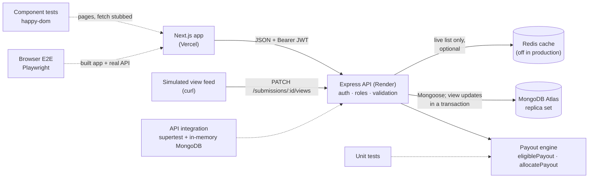

# Meme'd Campaign Payout Tracker

Brands run campaigns with a budget and a **milestone ladder** (for example 10,000 views → ₹500, 50,000 → ₹2,000, 1,00,000 → ₹5,000). Creators post for those campaigns on Instagram or YouTube and submit the links. As a post's views are reported, it earns the payout of the **highest milestone it has reached**, and the campaign pays that out until its budget runs out, never beyond it.

- **Live app:** https://memed-payout-tracker-livid.vercel.app
- **API:** https://memed-payout-tracker-95ju.onrender.com (health check: [`/api/health`](https://memed-payout-tracker-95ju.onrender.com/api/health))

The API runs on Render's free tier and sleeps when idle: the first request after a quiet spell can take up to a minute. Open the health check first before a demo.

**Contents:** [Try it](#try-it) · [Features](#features) · [Architecture](#architecture) · [Run it locally](#run-it-locally) · [Tests](#tests-and-checks) · [API reference](#api-reference) · [Payout rules](#payout-rules) · [Decisions](#decisions-and-assumptions) · [Deployment](#deployment) · [Scaling and operations](#scaling-and-operations) · [Limitations](#limitations)

## Try it

1. Sign up as a **brand**, choose **Create campaign**, and give it a budget and a ladder.
2. In another browser (or after logging out), sign up as a **creator**, open the campaign from **Live campaigns**, and submit a link to one Instagram post or reel, or a YouTube video, matching the campaign's platform.
3. Views are simulated: there is no button for them. Report a view count with the [`PATCH` example below](#simulate-view-updates). The creator's **My earnings** page and the brand's campaign page then show what was earned, paid and left unfunded.

## Features

- **Accounts:** sign up and log in as a brand or a creator; passwords hashed with bcrypt; JWT access tokens (7 days by default).
- **Brands:** create Instagram or YouTube campaigns with a total budget and a ladder of 1–10 milestones; see each campaign's budget, spent and remaining, and every post submitted to it with its views, eligible payout and paid amount.
- **Creators:** browse live campaigns; submit post links (the API normalises them, rejects other platforms and refuses the same post twice); see their posts and an earnings summary of paid, eligible and unfunded amounts.
- **Payouts:** a simulated view-update endpoint; payouts by highest milestone reached; never paying the same milestone twice; partial payouts when the budget is short; campaigns marked exhausted when their budget reaches zero.
- **View spikes:** an update that grows a post's views by 10,000 or more an hour is flagged on the submission for a person to review, without changing any payout (see [View-spike flag](#view-spike-flag)).
- **Live list cache (optional):** with `REDIS_URL` set, the creators' live campaign list is cached in Redis for up to 60 seconds; without it, as in production, every request reads MongoDB (see [Live campaign cache](#live-campaign-cache-redis)).
- **Safety:** role checks on every endpoint, brands limited to their own campaigns, creators to their own submissions and earnings; payout updates are transactional and safe under concurrent requests (see [Architecture](#architecture)).

## Architecture



| Part | Technology |
|---|---|
| Frontend | Next.js 16 (App Router), React 19, TypeScript, Tailwind CSS 4 |
| API | Node.js 22, Express 5, TypeScript, zod validation |
| Database | MongoDB (Atlas in production) with Mongoose 9 |
| Cache | Optional Redis through `@redis/client`, for the live campaign list only; not used in production |
| Auth | JWT (HS256) in a Bearer header; bcrypt password hashes |
| Tests | Jest + supertest + mongodb-memory-server (API); `node --test` + happy-dom (frontend); Playwright (browser) |
| Tooling | pnpm workspaces, Turborepo; Docker Compose for local runs |

**Request flow.** The browser calls the API directly with the JWT in an `Authorization: Bearer` header (the API sets no cookies). Each route checks the token and role, validates the body with zod, and answers JSON; errors always have the shape `{ "error": { "code", "message", "details"? } }`.

**Why view updates use a transaction.** One update changes two documents: the submission's paid amount and the campaign's spend. They must change together, and two updates competing for the same budget must not both spend it. `recordViews()` reads both inside a MongoDB transaction (snapshot reads, majority writes), computes the payout, and writes both with conditions on the values it read; a conflicting concurrent change makes the transaction retry (up to 3 times, then `409 CONCURRENT_UPDATE`). The API tests send ten identical updates at once and several posts competing for one budget, and check that nothing is paid twice and spend never exceeds the budget. Transactions need a replica set, which is why local MongoDB must be one (below).

Frontend structure, session handling and route protection are described in [`apps/frontend/ARCHITECTURE.md`](apps/frontend/ARCHITECTURE.md).

```
apps/server     Express API (src/modules: auth, campaigns, submissions, payouts) and its Jest tests
apps/frontend   Next.js app (src/app routes, src/components, src/lib) and its unit/component tests
apps/e2e        Playwright browser tests and the scripts that start the app for them
```

## Run it locally

**Prerequisites:** Node.js 22 (see `.nvmrc`) and pnpm 10.34.6. With Corepack, `corepack enable` picks up the pinned pnpm from `package.json`. You also need a MongoDB **replica set** (next section), which [Docker](#docker) can provide.

```bash
pnpm install --frozen-lockfile
```

### MongoDB

The API needs a MongoDB that is a replica set, because view updates run in transactions. On a standalone MongoDB the app starts and most pages work, but the first view update fails with `500 INTERNAL_ERROR`.

- **Docker:** `docker compose up -d mongo` starts MongoDB 8.2 as a single-node replica set on `127.0.0.1:27018`, and initiates it itself. Use `MONGODB_URI=mongodb://127.0.0.1:27018/memed_dev?directConnection=true`: the replica set names its member `mongo`, which only resolves inside Docker, so the driver must connect to it directly. Transactions work this way (checked: a committed write persists, an aborted one leaves nothing, and concurrent writes to one document raise a `WriteConflict`). For the optional cache, `docker compose up -d redis` and `REDIS_URL=redis://127.0.0.1:6379`.
- **Atlas:** a free cluster is already a replica set. Create a database user, allow your IP, and use its `mongodb+srv://…` connection string with a database name, e.g. `/memed_dev`.
- **Local MongoDB without Docker:** start a single-node replica set and initiate it once:
  ```bash
  mkdir data
  mongod --replSet rs0 --dbpath ./data --port 27017
  mongosh --eval "rs.initiate()"     # in a second terminal, once
  ```
  then use `MONGODB_URI=mongodb://127.0.0.1:27017/memed_dev?replicaSet=rs0`.

Databases are kept apart by name: `memed_dev` for local development, `memed_prod` on Render, and the tests never touch either: they start their own throwaway in-memory replica sets (`memed_test` for API tests, `memed_e2e` for browser tests).

### Environment variables

Copy `apps/server/.env.example` to `apps/server/.env` (the server reads it at startup) and, if needed, `apps/frontend/.env.example` to `apps/frontend/.env.local`. Never commit either.

| Variable | Where | Required | Meaning |
|---|---|---|---|
| `MONGODB_URI` | server | yes | `mongodb://` or `mongodb+srv://` URI that names a database |
| `JWT_SECRET` | server | yes | At least 32 random characters; the `.env.example` placeholder is refused |
| `JWT_EXPIRES_IN` | server | no | Token lifetime such as `7d`, `12h` (default `7d`) |
| `PORT` | server | no | Default `4000` |
| `NODE_ENV` | server | no | `development` (default), `test` or `production` |
| `CORS_ORIGINS` | server | in production | Comma-separated browser origins; in development defaults to `http://localhost:3000,http://localhost:3001` |
| `REDIS_URL` | server | no | `redis://` or `rediss://` URL to cache the live campaign list; leave unset for no cache (production leaves it unset) |
| `NEXT_PUBLIC_API_URL` | frontend | no locally | API origin, default `http://localhost:4000`; inlined at build time, so rebuild after changing it |

The server validates these at startup and refuses to start with a clear message (naming the variable, never echoing its value). The tests need no environment variables.

### Start

```bash
pnpm dev
```

This starts the API on http://localhost:4000 and the frontend on http://localhost:3000. If port 3000 is taken, Next.js moves to the next free port and prints it; the API's development CORS default allows 3000 and 3001, so set `CORS_ORIGINS` if the frontend ends up elsewhere.

### Docker

`compose.yaml` runs MongoDB, Redis, the API and the web app on your machine. It is for local work only: production stays on Vercel and Render. With Docker running:

```bash
cp .env.example .env           # then set JWT_SECRET; the API refuses the placeholder
docker compose up -d --build   # the whole stack, from production builds
docker compose ps              # wait until all four services are "healthy"
```

The web app is then at http://localhost:3200 and the API at http://localhost:4200. For development with hot reload, start only the databases instead (`docker compose up -d mongo redis`, which needs no `.env`) and run `pnpm dev` with the connection strings from [MongoDB](#mongodb).

| Service | Image | Host port | Ready when |
|---|---|---|---|
| `mongo` | `mongo:8.2.12`, replica set `rs0` | 27018 | the replica set is initiated and this node is primary |
| `redis` | `redis:8.2.10-alpine`, nothing kept on disk | 6379 | `redis-cli ping` answers |
| `api` | `apps/server/Dockerfile`, database `memed_docker`, cache on | 4200 | `GET /api/health` answers 200 |
| `web` | `apps/frontend/Dockerfile` | 3200 | `GET /` answers |

- The API waits for a healthy MongoDB but only a started Redis, since it works without its cache; the web app waits for a healthy API.
- Every port is bound to `127.0.0.1`, because nothing has a password locally. Ports can be changed in `.env`; the web image has the API's address built in (`NEXT_PUBLIC_API_URL`), so rebuild with `--build` after changing `API_PORT`.
- MongoDB's data is kept in the `memed_mongo-data` volume across restarts. `docker compose down` stops everything; **`docker compose down -v` also deletes that volume**, which wipes the local Docker databases (and nothing else: Atlas and production are not touched). Redis keeps nothing on disk.
- Both images run as a non-root user with production dependencies only; no `.env` file enters an image (see `.dockerignore`).

## Tests and checks

```bash
pnpm test        # API unit + integration, frontend unit + component
pnpm typecheck
pnpm lint
pnpm build
pnpm e2e         # browser tests (separate: needs a browser, takes about a minute)
```

| Layer | What it proves | Count |
|---|---|---|
| API unit (`apps/server/tests/unit`) | Payout engine, view-spike rule, cache fail-open rules (timeouts, rejections, malformed data), ladder rules, URL normalisation, validation schemas, env checks | 205 |
| API integration (`apps/server/tests/integration`) | Every endpoint over HTTP against an in-memory MongoDB replica set: auth, roles, ownership, payouts, partial payouts, exhaustion, view spikes, the live-list cache (invalidation, fallback), concurrency, the whole brand-to-creator workflow; the Redis client against an unreachable server, and against a real Redis when one is given | 198, plus 6 that need a real Redis (all 204 pass with one) |
| Frontend unit (`apps/frontend/src/**/*.test.ts`) | API client, session store, route decisions, form checks, formatting | 75 |
| Frontend component (`apps/frontend/src/**/*.test.tsx`) | React pages rendered in happy-dom with `fetch` stubbed: loading, empty, error, retry, validation, duplicate submits | 52 |
| Browser E2E (`apps/e2e/tests`) | Real Chromium against a production build and the real API on a throwaway database: the full workflow, route protection, reloads, expired sessions, cross-tab logout, isolation, network failures | 9 |

The first API test run downloads a MongoDB binary for the in-memory database. On a new machine, install Playwright's browser once before `pnpm e2e`:

```bash
pnpm --filter e2e exec playwright install chromium
```

**Tests against a real Redis.** Six API tests (`apps/server/tests/integration/redis.real.test.ts`) are skipped unless `REDIS_TEST_URL` is set. They delete keys, drop connections and pause the server, so they only accept a local URL; point them at the Compose Redis (a Docker API using it reconnects by itself):

```bash
docker compose up -d redis
REDIS_TEST_URL=redis://127.0.0.1:6379 pnpm --filter server test
```

In PowerShell, set it first with `$env:REDIS_TEST_URL = "redis://127.0.0.1:6379"`.

`pnpm e2e` builds the API and the frontend (pointed at `http://localhost:4100`), starts them on ports 4100 and 3100 (which must be free), runs the tests, and stops them. The browser tests run locally only; there is no CI pipeline. Checks of the deployed site (production configuration, the live workflow against Atlas) were done by hand and are not automated.

## API reference

Base path `/api`. Send JSON with `Content-Type: application/json`; authenticated endpoints need `Authorization: Bearer <token>`. Responses are JSON. Money is whole rupees.

| Method and path | Who | Request | Response |
|---|---|---|---|
| `GET /health` | anyone | | `200 { status, database, uptime }`, or `503` when the database is disconnected |
| `POST /auth/signup` | anyone | `{ name, email, password, role }` | `201 { token, user }` |
| `POST /auth/login` | anyone | `{ email, password }` | `200 { token, user }` |
| `GET /auth/me` | signed in | | `200 { user }` |
| `POST /campaigns` | brand | `{ name, platform, totalBudget, milestones: [{ views, payout }] }` | `201 { campaign }` |
| `GET /campaigns/mine` | brand | | `200 { campaigns }`, own campaigns, newest first |
| `GET /campaigns/live` | creator | | `200 { campaigns }`, every live campaign, newest first (up to 60 s stale when the [cache](#live-campaign-cache-redis) is on) |
| `GET /campaigns/:id` | brand (own) or creator | | `200 { campaign }` |
| `GET /campaigns/:id/submissions` | brand (own) | | `200 { submissions }` |
| `POST /submissions` | creator | `{ campaignId, postUrl }` | `201 { submission }` |
| `GET /submissions/mine` | creator | | `200 { submissions }`, own posts, newest first |
| `GET /submissions/earnings` | creator | | `200 { earnings: { totalPaid, totalEligible, totalUnfunded, submissionCount } }` |
| `PATCH /submissions/:id/views` | anyone (simulated feed) | `{ views }` | `200 { submission, allocation, campaign, viewSpikeDetected }` |

- `user`: `{ id, name, email, role, createdAt }`. `campaign`: `{ id, name, platform, totalBudget, spent, remaining, milestones, status, createdAt }` with `status` `live` or `exhausted`. `submission`: `{ id, campaignId, platform, postUrl, normalizedUrl, views, eligiblePayout, paidPayout, viewSpike, createdAt }`, where `viewSpike` is `null` or `{ detectedAt, fromViews, toViews, viewsPerHour }` (see [View-spike flag](#view-spike-flag)).
- Owner ids are never sent; ownership always comes from the token, and fields a client should not set (`brandId`, `spent`, `status`, payouts) are ignored.
- Another brand's campaign answers `404`, exactly like a missing one.

**Validation rules.**
- Signup: name 2–60 characters; a valid email (stored lowercase, unique); password at least 8 characters and at most 72 bytes; role `brand` or `creator`.
- Campaign: name 1–80 characters; platform `instagram` or `youtube`; whole-rupee budget from 1 to 2,147,483,647; 1–10 milestones whose views and payouts both strictly increase; no payout above the budget. Campaigns cannot be edited after creation.
- Post link: an `http(s)` link to one Instagram post, reel or IGTV video, or one YouTube video (`watch?v=`, `youtu.be`, Shorts, live or embed links), at most 2,048 characters. It is stored in a canonical form, which must be unique across all campaigns.
- View count: a whole number, never below the post's current count.

**Error codes.**

| Status | Codes |
|---|---|
| 400 | `VALIDATION_ERROR` (with `details: [{ path, message }]`), `INVALID_JSON`, `PLATFORM_MISMATCH` |
| 401 | `UNAUTHENTICATED`, `INVALID_TOKEN`, `TOKEN_EXPIRED`, `INVALID_CREDENTIALS` |
| 403 | `FORBIDDEN` (wrong role) |
| 404 | `NOT_FOUND` |
| 409 | `EMAIL_TAKEN`, `CAMPAIGN_NOT_LIVE`, `DUPLICATE_POST`, `VIEWS_DECREASED`, `CONCURRENT_UPDATE` |
| 413 | `PAYLOAD_TOO_LARGE` (bodies over 10 KB) |
| 429 | `RATE_LIMITED`: signup and login share 20 requests per 15 minutes per client; view updates allow 120 per minute |
| 500 | `INTERNAL_ERROR` (details only in the server log) |

### Simulate view updates

Views have no UI: report them as the platform feed would. Find a submission's id in the creator's `GET /api/submissions/mine` (or the brand's `GET /api/campaigns/:id/submissions`), then:

```bash
API=http://localhost:4000   # or https://memed-payout-tracker-95ju.onrender.com

curl -s -X PATCH "$API/api/submissions/<submission-id>/views" \
  -H "Content-Type: application/json" \
  -d '{"views": 60000}'
```

The response reports what happened:

```json
{
  "submission": { "id": "<submission-id>", "views": 60000, "eligiblePayout": 2000, "paidPayout": 2000, "...": "..." },
  "allocation": { "grantedNow": 2000, "unfundedPayout": 0, "outcome": "paid" },
  "campaign": { "remaining": 4000, "status": "live" },
  "viewSpikeDetected": true
}
```

`outcome` is `paid`, `partial` (the budget covered only part), `budget_exhausted` (nothing left to pay), `no_new_payout` (no new milestone reached) or `no_change` (same count as before; nothing written). `viewSpikeDetected` is `true` here because 60,000 views arrived within an hour of the post's last count; it does not change the payout.

To get a submission id from the command line, sign in as the creator and list their posts:

```bash
curl -s -X POST "$API/api/auth/login" -H "Content-Type: application/json" \
  -d '{"email": "<creator-email>", "password": "<creator-password>"}'      # copy "token"

curl -s "$API/api/submissions/mine" -H "Authorization: Bearer <creator-token>"   # copy an "id"
```

## Payout rules

- A post's **eligible payout** is the payout of the **highest milestone its views have reached** (reaching a threshold exactly counts), not the sum of the milestones it passed.
- What the post is still **owed** is its eligible payout minus what it has already been paid. A repeated or lower milestone never pays again.
- The campaign pays what is owed **up to its remaining budget**. If the budget is short, it pays what is left (a **partial payout**) and the rest stays **unfunded**.
- When spend reaches the budget the campaign becomes **exhausted**: it leaves the live list and accepts no new posts. Views on existing posts are still recorded, so their eligible amount can grow, but nothing more is paid. Budgets cannot be topped up, so unfunded amounts are never paid later.
- A view count may not decrease (`409 VIEWS_DECREASED`).

**Worked example** (checked against the API): budget ₹6,000, ladder 10,000 → ₹500, 50,000 → ₹2,000, 1,00,000 → ₹5,000, two posts by one creator.

| Update | Eligible | Paid now | Post's total paid | Campaign remaining | Outcome |
|---|---|---|---|---|---|
| Post A → 60,000 views | ₹2,000 | ₹2,000 | ₹2,000 | ₹4,000 | `paid` (two milestones crossed, only the higher one pays) |
| Post A → 60,000 again | ₹2,000 | ₹0 | ₹2,000 | ₹4,000 | `no_change` |
| Post A → 1,20,000 | ₹5,000 | ₹3,000 | ₹5,000 | ₹1,000 | `paid` (the difference only) |
| Post B → 1,20,000 | ₹5,000 | ₹1,000 | ₹1,000 | ₹0, exhausted | `partial` (₹4,000 unfunded) |
| Post B → 1,50,000 | ₹5,000 | ₹0 | ₹1,000 | ₹0 | `budget_exhausted` |

The creator's earnings then read: paid ₹6,000, eligible ₹10,000, unfunded ₹4,000, 2 posts. The campaign has spent exactly its ₹6,000 budget. Run in quick succession like this, every update except the repeat is also flagged as a view spike (below); none of the amounts change because of it.

## View-spike flag

The API flags a view update that grows a post's count unusually fast, as a signal for a person to review. It is not fraud detection: the app never sees real Instagram or YouTube data, only the counts reported to it, so a flag means those counts grew fast, not that the views are fake.

**The rule.** An update is a spike when

```
views gained / max(hours since the previous count was recorded, 1) >= 10,000 views an hour
```

- The previous count is the post's last recorded view count; for its first update, that is 0 views at the moment it was submitted.
- Time is floored at one hour, so reports seconds apart cannot turn a small gain into a huge rate: within an hour, only a gain of 10,000 views or more is flagged.
- Milestones play no part. Ordinary growth that crosses a milestone is never flagged; a jump is flagged for its speed, whatever it pays.
- Repeating the same count writes nothing, so it neither flags nor restarts the clock. A lower or invalid count is rejected before the rule runs.

| Update | Gain | Since the previous count | Rate | Flagged |
|---|---|---|---|---|
| 0 → 60,000, minutes after submitting | 60,000 | 5 minutes (counted as 1 hour) | 60,000/h | yes |
| 9,000 → 10,500, crossing the ₹500 milestone | 1,500 | 2 hours | 750/h | no |
| 10,500 → 1,00,000 | 89,500 | 24 hours | 3,729/h | no |
| 50,000 → 70,000 on a post submitted three days ago | 20,000 | 10 minutes (counted as 1 hour) | 20,000/h | yes |

**Reading the flag.**

- The view-update response's `viewSpikeDetected` says whether that update was a spike.
- Every submission carries `viewSpike`: `null`, or the latest spike as `{ detectedAt, fromViews, toViews, viewsPerHour }`. It stays after later ordinary updates as evidence, so the brand's list of a campaign's submissions (`GET /campaigns/:id/submissions`) shows which posts to look at. Creators see it on their own posts too.
- The flag never changes payouts: a flagged update earns and is paid exactly what an unflagged one would, within the same budget cap. Holding back or reversing a payment is left to a person.
- It is computed inside the same transaction as the payout and saved by the same conditional write, so racing updates cannot record a spike against a count that was already replaced.

**Limitations.**

- One fixed threshold for every post. A very large account that grows steadily faster than 10,000 views an hour is flagged on every report, and a small account's unusual jump below it is not. Comparing a post with its own earlier growth would adapt, at the cost of storing more history.
- It is only as precise as the feed's reporting: a burst between two reports a day apart is averaged over the day.
- Only the latest spike is kept, with no reviewed or dismissed state, and the web app does not show it yet.
- Creators can read the rule and their own flags; a real anti-fraud signal might be kept from them.

## Live campaign cache (Redis)

Optional, and off in production. With `REDIS_URL` set, the creators' live campaign list (`GET /api/campaigns/live`) is cached in Redis. It is the only cached response: it is the same for every creator, and it is discovery data, so a short delay before it changes is acceptable. MongoDB stays the source of truth for everything else.

- **Read-through:** the token and creator role are checked first; then the list comes from the cache, or on a miss from MongoDB, and is stored for **60 seconds** under the key `memed:campaigns:live:v1`. Cached entries are checked against the same rules as the API's own responses (exact fields, an ObjectId, whole rupees with `remaining = totalBudget - spent`, a valid ladder, `live` status), and anything else is treated as a miss, so only data the API itself could have sent is served.
- **Invalidation:** creating a campaign, and any view update that pays (after its transaction has committed), delete the cached list, so the next request rebuilds it with the new spend and without campaigns that have run out.
- **Never cached:** submitting a post (the campaign's status is re-read from MongoDB), payouts and budgets (the view-update transaction), a campaign's own page, brand pages, submissions and earnings. Cached figures never decide money or access.
- **When Redis is down or slow:** every cache command is bounded by 250 ms and fails open: an error, a timeout or malformed cached data counts as a miss, and the list is read from MongoDB. While Redis is disconnected, commands fail at once instead of queueing; the client reconnects in the background (backoff capped at 5 seconds), the API never waits for it at startup, and an outage is logged once, without the URL.

**How stale can the list be?** Normally not at all, because changes delete it. Two cases can leave it stale for up to 60 seconds: a read that began before a payment committed stores the older figures just after the delete, or a delete is lost because Redis was unreachable at that moment. The worst effect is a card showing an old spend, or an exhausted campaign still listed; opening it reads MongoDB, and submitting a post to it is refused (`409 CAMPAIGN_NOT_LIVE`).

**Testing and status.** Unit tests cover the 250 ms bound (with a store that never answers), rejections, malformed data and log volume; integration tests check invalidation, fallback, the auth check before the cache, and that submissions and payouts ignore cached figures; the real Redis client is run against an unreachable server. Against a real Redis 8.2 (the Compose service), six more tests check that keys expire after their time to live, the cached list's 60-second TTL and hits, invalidation on creation and payment with payout invariants intact, reconnection after Redis drops the connection, and the MongoDB fallback while Redis is paused (see [Tests and checks](#tests-and-checks)). In the full Docker stack, stopping the Redis container leaves the live list served from MongoDB, and starting it again reconnects the API on its own. To use the cache locally, start Redis (`docker compose up -d redis`) and set `REDIS_URL=redis://127.0.0.1:6379` in `apps/server/.env`, or run the whole Docker stack, where it is on.

## Decisions and assumptions

- **One update crossing several milestones** pays only the highest one reached, minus anything already paid.
- **Budget running out mid-payout:** the post gets whatever is left (a partial payout); the remainder is recorded as unfunded, not owed later.
- **Eligible vs paid** are stored separately on each submission, so the gap between what views earned and what the budget covered is always visible.
- **The view-update endpoint needs no authentication**, as the brief specifies, because it stands in for a platform's data feed. It reads only `views` and is rate-limited.
- **Duplicate posts** are detected on the canonical link, across all campaigns and creators.
- **Campaigns are immutable** once created: changing the ladder or budget would change what creators were already promised.
- **Creators may open any campaign** by id, including exhausted ones, but only ever see their own submissions.

## Deployment

| | Service | Configuration |
|---|---|---|
| Frontend | Vercel, project root `apps/frontend` | `NEXT_PUBLIC_API_URL` = the Render API origin |
| API | Render web service | Build `npx --yes pnpm@10.34.6 install --frozen-lockfile && npx --yes pnpm@10.34.6 --filter server build`; start `node apps/server/dist/index.js`; env `NODE_ENV=production`, `MONGODB_URI` (database `memed_prod`), `JWT_SECRET`, `CORS_ORIGINS` = the Vercel origin |
| Database | MongoDB Atlas | Replica set; IP allowlist for Render |

These settings live in the Vercel and Render dashboards, not in the repository. Both services deploy from `main`. No Redis is provisioned: `REDIS_URL` is unset on Render, so production reads the live campaign list from MongoDB.

## Scaling and operations

### Scaling to 10,000 creators

Production runs one API instance. What already holds with several:

- **Budgets cannot be overspent.** The guarantee is enforced by MongoDB, not by process memory: each paying view update is a transaction whose writes are conditional on the values it read ([Architecture](#architecture)), so two instances racing for a campaign's last rupees behave like two requests to one instance.
- **Any instance can answer any request.** The JWT is verified on every request and no session state lives on the server. The web app on Vercel scales on its own.
- **The live-list cache is shared.** With Redis on, all instances read and invalidate the same key; a lost invalidation is still bounded by the 60-second expiry, and an outage falls back to MongoDB ([Live campaign cache](#live-campaign-cache-redis)).

What must change first, roughly in this order:

1. **Rate limits** are counted in each process's memory, so N instances allow N times the limit and a restart resets it. They need a shared store (Redis is already in the stack). They key on Cloudflare's `CF-Connecting-IP`, which Render provides; behind another proxy the client key needs revisiting.
2. **Connections:** each API process may open up to 100 MongoDB connections (the driver's default; this code sets no pool size). Set `maxPoolSize` so that instances × pool size stays within the cluster's connection limit.
3. **Pagination:** `/campaigns/mine`, `/campaigns/live`, `/submissions/mine` and a campaign's submissions return every record. Cursor pagination can use the existing `createdAt` indexes; earnings totals are already one indexed aggregation.
4. **The view feed:** the brief's endpoint is public and limited to 120 updates a minute per client, which a single real platform feed would exceed. A real feed would be an authenticated, batched ingestion path or a queue.
5. **Busy campaigns:** every paying update for a campaign writes that campaign's `spent`, so concurrent updates for one popular campaign conflict and retry, and after 3 attempts the API answers `409 CONCURRENT_UPDATE` for the feed to retry. If that becomes common, one queue consumer per campaign would serialise them.

For scale, assuming 5 live posts per creator updated hourly, 10,000 creators produce about 50,000 view updates an hour, or 14 a second, each a small transaction. That is modest for one MongoDB replica set; the changes above are about per-process limits and contention, not raw volume.

### Operations

- **Health check:** `GET /api/health` reports the database connection from the driver's state, without querying on every probe, and answers `503` when disconnected. Docker Compose uses it; Redis is deliberately left out of it.
- **Shutdown:** on `SIGTERM` (Render sends it on every deploy) or `SIGINT`, the API stops accepting connections, lets in-flight requests finish, closes Redis and MongoDB, and exits; anything still running after 10 seconds makes it exit with an error.
- **Configuration and secrets:** environment variables are validated at startup and their values never printed. Secrets live in the Render and Vercel dashboards and in git-ignored `.env` files. Changing `JWT_SECRET` signs everyone out, because existing tokens stop verifying.
- **Logs** go to stdout and stderr only: startup, cache outages, shutdown, and unexpected errors with their stack. They are read in the hosting dashboards; there is no request logging, metrics, tracing or alerting.
- **Backups:** this project sets none up; they depend on the MongoDB Atlas plan.
- **Deploys:** pushing to `main` deploys both services. There is no CI or staging environment; the checks in [Tests and checks](#tests-and-checks) are run locally before pushing.

## Limitations

- **Views are simulated.** There is no UI to report views and no integration with Instagram or YouTube; submitted posts are not checked to exist. Anyone can call the view-update endpoint (per the brief); it is only rate-limited.
- **Cold starts:** the free Render instance sleeps when idle; the first request can take up to a minute (the UI says so while it waits).
- **Rate limits are kept in memory,** per server instance, and reset when it restarts or redeploys.
- **Sessions:** the JWT is kept in `localStorage` (see the trade-off in `ARCHITECTURE.md`); there is no refresh, revocation or password reset, and logging out only clears the browser.
- **No editing:** campaigns cannot be edited, paused, deleted or topped up. Lists are not paginated.
- **Earnings page requests:** submissions carry only a campaign id, so the creator's earnings page fetches each distinct campaign once to show its name.
- **Tests:** browser tests run locally with Chromium only; there is no CI. Production checks are manual.
- **Database user:** development and production use one Atlas user with access to both databases; separate users per environment would be safer.
- **Optional items from the brief:** all are covered. The scaling note is [Scaling and operations](#scaling-and-operations). Implemented and tested: concurrent payout safety, view-spike flagging (with the limitations listed in [View-spike flag](#view-spike-flag)), Redis caching of the live campaign list (tested against a real Redis locally, not deployed; see [Live campaign cache](#live-campaign-cache-redis)), and Docker for local runs (see [Docker](#docker); production does not use it).
